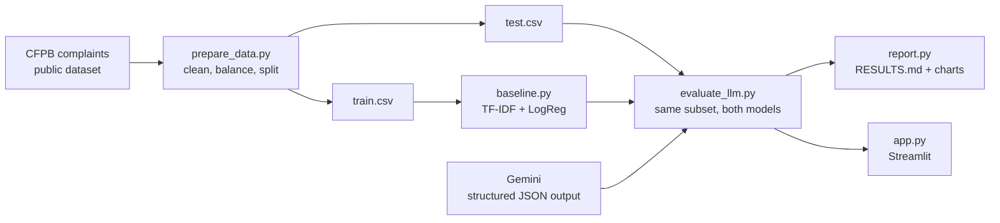

# Bank Complaint Classifier

An LLM that reads a customer complaint, decides which banking product it is about, rates
its urgency and routes it to the right team — measured against a classical
TF-IDF + Logistic Regression model on the same real complaints.

**Question this project answers:** does a zero-shot LLM, which has never seen a labelled
example, match a model trained on thousands of them? And what does it add that the
classical model cannot?

## What it does

- **Classifies** each complaint into one of 7 banking categories and maps it to the team that should handle it.
- **Rates urgency** (high / medium / low) and sentiment, and writes a one-sentence summary.
- **Works in Turkish too** — the LLM classifies complaints in any language; the summary comes back in the complaint's language.
- **Compares honestly**: both models are scored on the same stratified test set with accuracy, macro F1 and confusion matrices.
- **Streamlit app** for single complaints, batch CSV/Excel uploads with Excel export, and exploring every prediction.

## Results

The evaluation writes its tables and charts to [`results/RESULTS.md`](results/RESULTS.md).
Run the pipeline below to (re)create them.

## How it works



| Category | Routed to | CFPB products merged into it |
| --- | --- | --- |
| Bank account | Retail Banking Operations | Checking or savings account, Bank account or service |
| Credit & prepaid card | Card Services | Credit card, Credit card or prepaid card, Prepaid card |
| Mortgage | Mortgage Servicing | Mortgage |
| Consumer loan | Consumer Lending | Vehicle, payday, title, personal and student loans |
| Money transfer | Payments & Transfers | Money transfer, virtual currency, money service |
| Debt collection | Collections | Debt collection |
| Credit reporting | Credit Bureau Relations | Credit reporting and consumer reports |

## Design decisions

- **Balanced, stratified sample.** The raw data is dominated by credit-reporting complaints. Sampling the same number per category keeps the comparison from rewarding a model that just predicts the majority class; macro F1 is reported for the same reason.
- **Same test rows for both models.** The LLM is rate-limited, so it is scored on a subset; the baseline is re-scored on exactly that subset.
- **Structured output with an enum.** Gemini must return JSON matching a Pydantic schema whose category field only allows the 7 classes, so there is no free-text parsing and no invented labels.
- **Temperature 0 and a disk cache.** The same complaint always gets the same answer, re-runs cost nothing, and results are reproducible.
- **Rate limiting with exponential back-off** on 429/5xx errors, so the free tier is enough. Failed calls are counted as wrong answers, never silently dropped.
- **Streaming data preparation.** The multi-GB CFPB file is read in chunks and sampled with random keys, so it never has to fit in memory.

## Quickstart

```bash
git clone https://github.com/aygunduzumutberke/<this-repo>.git
cd <this-repo>
python -m venv .venv
source .venv/bin/activate          # Windows: .venv\Scripts\activate
pip install -r requirements.txt
cp .env.example .env               # Windows: copy .env.example .env  — then add your Gemini key
```

**Try it in two minutes, no download and no API key** (synthetic data, keyword rules — the scores mean nothing, this only checks the setup):

```bash
python scripts/make_demo_data.py
python -m src.prepare_data --demo
python -m src.baseline
python -m src.evaluate_llm --per-class 5 --provider mock
streamlit run app.py
```

**Full run on real data:**

1. Get the data. On 14 Aug 2026 the CFPB stopped publishing complaint narratives, so they are downloaded from a public Hugging Face mirror made before that ([`Mouwiya/cfpb-consumer-complaints`](https://huggingface.co/datasets/Mouwiya/cfpb-consumer-complaints), Jan 2025 – Jan 2026). Four ~15 MB shards are enough:

```bash
python scripts/download_cfpb.py --shards 4
```

2. Run:

```bash
python -m src.prepare_data --input data/raw/cfpb_sample.csv --per-class 1500
python -m src.baseline
python -m src.evaluate_llm --per-class 30      # 210 LLM calls, ~30 min on the free tier
python -m src.report
streamlit run app.py
```

Tests: `pytest` (the Gemini SDK is faked, so no key or network is needed).

## Project structure

```
app.py                  Streamlit app
src/config.py           paths, categories, CFPB product mapping, settings from .env
src/prepare_data.py     stream, clean, balance and split the CFPB data
src/baseline.py         TF-IDF + Logistic Regression
src/llm_classifier.py   Gemini classifier: prompt, schema, cache, rate limit, retries, mock mode
src/evaluate_llm.py     score both models on the same complaints
src/metrics.py          shared evaluation
src/report.py, plots.py RESULTS.md and charts
scripts/make_demo_data.py  synthetic sample for a quick test run
tests/                  pytest suite
```

## Limitations

- CFPB complaints are from US consumers; categories and wording differ from Turkish banking. The Turkish support is the LLM's zero-shot ability and is not measured against labelled Turkish data.
- Urgency and sentiment come from the LLM and have no ground-truth labels, so they are not scored.
- The baseline is English-only.
- The LLM is evaluated on a few hundred complaints because of free-tier limits; with 210 complaints, an accuracy figure is only precise to about ±5 percentage points.

## Data

Complaints filed with the U.S. [Consumer Financial Protection Bureau](https://www.consumerfinance.gov/data-research/consumer-complaints/) between January 2025 and January 2026, taken from the public Hugging Face mirror [`Mouwiya/cfpb-consumer-complaints`](https://huggingface.co/datasets/Mouwiya/cfpb-consumer-complaints). The CFPB removed personal information before publishing and [stopped publishing narratives in August 2026](https://www.consumerfinancemonitor.com/2026/08/18/cfpb-ends-publication-of-consumer-complaint-narratives-and-data-visualizations/). The raw data is not stored in this repository.

On Windows, `run_demo.bat` sets everything up and runs the offline demo; `run_real.bat` runs the full pipeline on real data.

## License

MIT
