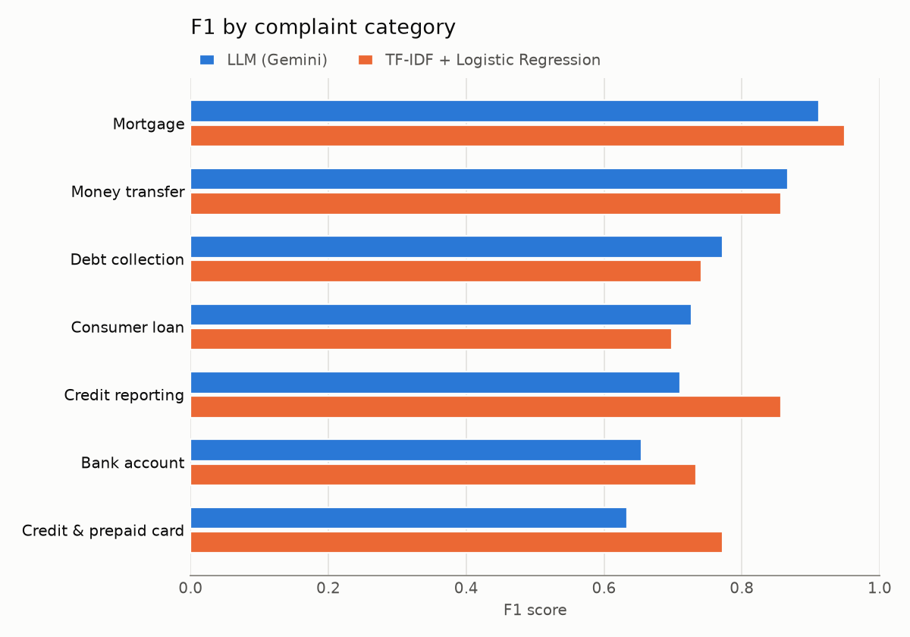
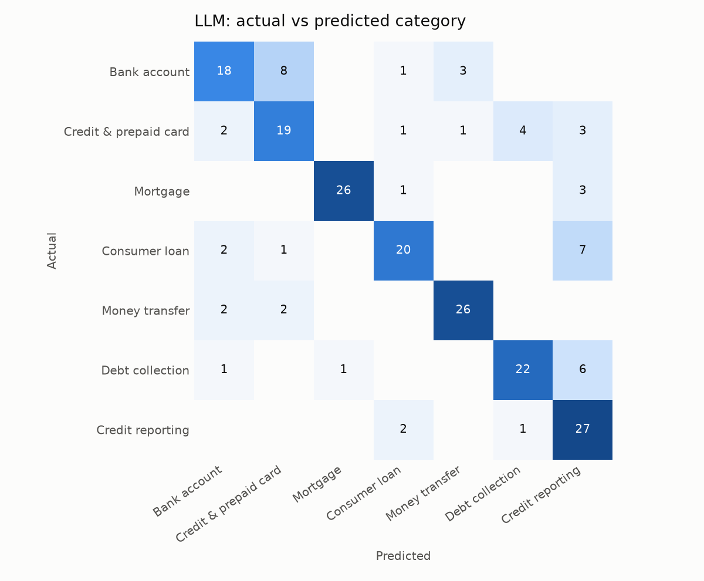
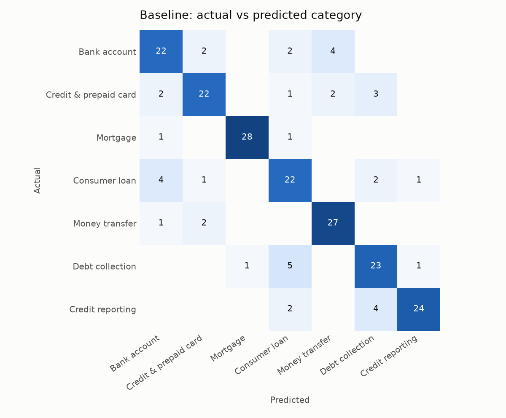

# Results

Both models were scored on the same **210 test complaints** (30 per category). The baseline was trained on 6,988 complaints; the LLM saw no training examples (zero-shot). LLM: `gemini-flash-lite-latest`.

| Model | Accuracy | Macro F1 | Speed |
| --- | --- | --- | --- |
| LLM (zero-shot) | 75.2% | 0.754 | ~15.5 s per complaint (median) |
| TF-IDF + Logistic Regression | 80.0% | 0.801 | < 1 ms per complaint |

Only the LLM was right on 12 complaints, only the baseline on 22, and both were wrong on 30. Failed LLM calls (scored as wrong): 0.

## F1 by category

| Category | LLM | Baseline |
| --- | --- | --- |
| Bank account | 0.654 | 0.733 |
| Credit & prepaid card | 0.633 | 0.772 |
| Mortgage | 0.912 | 0.949 |
| Consumer loan | 0.727 | 0.698 |
| Money transfer | 0.867 | 0.857 |
| Debt collection | 0.772 | 0.742 |
| Credit reporting | 0.711 | 0.857 |

## Where the models get confused

## Urgency assigned by the LLM

| Urgency | Complaints |
| --- | --- |
| high | 144 |
| medium | 59 |
| low | 7 |

## Examples the LLM got wrong

| Actual | LLM said | Complaint (first 160 chars) |
| --- | --- | --- |
| bank_account | card | Representatives were combative with me starting with demanding multiple forms of authorization that is not proper protocol. Calls that must be looked into : XXX… |
| card | debt_collection | To Whom It May Concern, Account Name : American Express Account Number : XXXX I am formally disputing the above-referenced account reported by American Express … |
| bank_account | money_transfer | I sent {$3000.00} over to my Cash App account from My main banking, which is Bank XXXX XXXX around XX/XX/year>. As of XX/XX/year> when I was trying to use my mo… |
| bank_account | card | I am filing a complaint against U.S. Bank regarding their handling of a disputed debit card transaction in the amount of {$340.00}. I reported this charge as un… |
| bank_account | card | I am filing a complaint regarding an unauthorized debit card transaction that my bank, M & T Bank, has refused to properly investigate under the Electronic Fund… |
